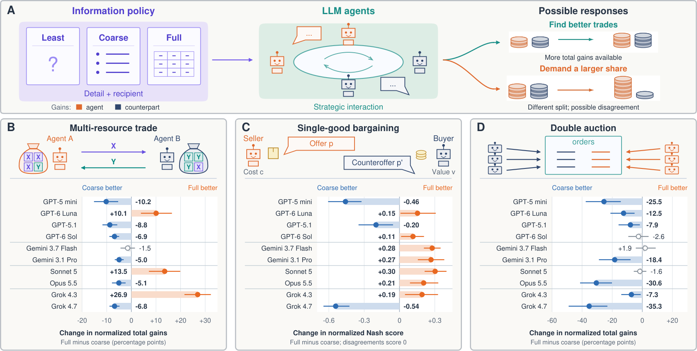
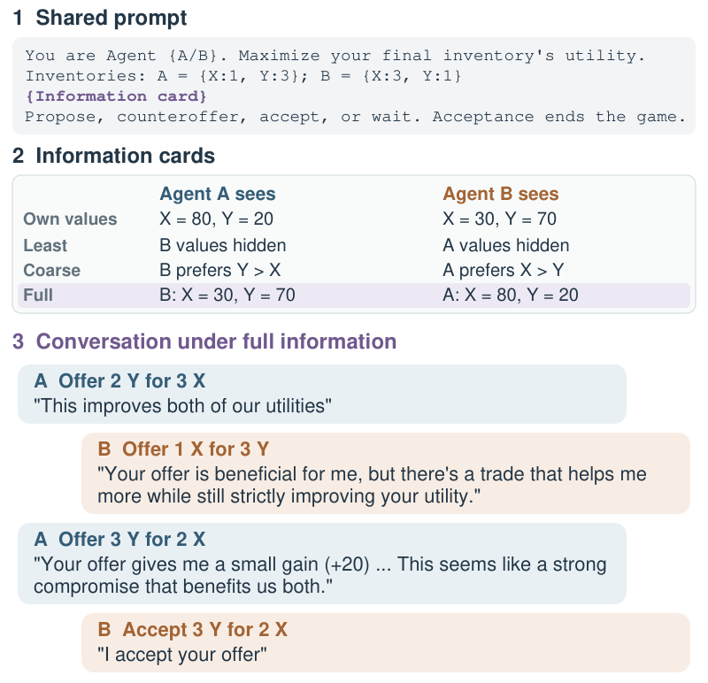

# Who Should Know What?

### Empirical Information Design for Multi-Agent LLM Economies

Giving an agent more information can help it find a better trade. It can also
change what it demands, leaving both sides with less to show for the negotiation.
We study this tension in resource exchange, bargaining, and double auctions,
comparing information policies on the same markets with the same models and rules.

This repository contains the experiment code, prompts, market generators, and
evaluation tools used in the paper. The published market inputs are included;
the complete model-run logs are not.

[Quick start](#quick-start) · [The games](#three-games) ·
[Running experiments](#running-experiments) · [Code and data](#code-and-data)



*Moving from coarse to full information helps some models and hurts others.
Trade and auction panels show changes in normalized total gains, in percentage
points. Bargaining uses the normalized Nash score across all negotiations,
including disagreements, at a six-message limit.*

## Three games

Each agent is instructed to maximize its own gains. We vary what it learns
about the other participants before they act, then score the interaction using
the underlying utilities, values, and costs.

| Setting | Interaction | Main study | Guide |
|---|---|---|---|
| **Multi-resource trade** | Two agents exchange resources through dialogue. | 90 market records; two resources; eight messages | [Trade](multiresource_trade/README.md) |
| **Single-good bargaining** | A buyer and seller negotiate a price. | 30 market instances; two, four, or six messages | [Bargaining](single_good_bargaining/README.md) |
| **Double auctions** | Three buyers and three sellers submit prices independently. | 30 markets; simultaneous orders; midpoint pricing | [Auctions](double_auction/README.md) |

The main comparisons use **least**, **coarse**, and **full** information.
Coarse information gives preference rankings in trade, confirms whether a
beneficial trade exists in bargaining, and gives separate buyer-value and
seller-cost rankings in auctions. Full information reveals exact values.
The guides also cover one-sided disclosure, mixed-model interactions, longer
conversations, additional resources, and mediated trade.

## Inside a negotiation

The information policy changes what the agents know, not their objective.
Below is a selected exchange from the paper, showing the information cards
and conversation under full disclosure. The shared prompt is abbreviated.

<p align="center">
  
</p>

This is why we look at both the offers and the final agreement. An agent can
identify a useful exchange without implementing it; an agreement can also
favor one participant heavily. The analysis reports **candidate quality (Q)**,
**realized performance (W)**, and their difference, the **realization gap (L)**.
Trade and auctions score total gains. Bargaining uses the normalized Nash
product, which captures both agreement and how evenly gains are divided.
The three settings are analyzed separately, not pooled into one score.

<a id="start-here"></a>
<a id="getting-started"></a>

## Quick start

Use Python 3.11 or later, Bash, and Git on macOS, Linux, or WSL.

```bash
git clone https://github.com/meterdogan07/agent-information-design.git
cd agent-information-design
python -m venv .venv
source .venv/bin/activate
python -m pip install -e '.[analysis]'
python export_markets.py --check
```

Preview a study without API credentials or paid calls:

```bash
python experiments.py main trade gpt51
python experiments.py main bargaining gpt51 --messages 6
python experiments.py main auction gpt51
```

The launcher prints the settings and underlying command. A trade preview may
save a generated market copy. Run `python experiments.py models` to list model
presets; use `--workers N` to change concurrency.

## Running experiments

Put the keys for the providers you use in a root `.env` file, which is ignored
by Git. Do not commit credentials.

```dotenv
OPENAI_API_KEY=your_key
OPENROUTER_API_KEY=your_key
ANTHROPIC_API_KEY=your_key
```

Preview first, then add `--mode execute` to make paid calls. For example:

```bash
python experiments.py main bargaining gpt51 --messages 6 \
  --mode execute --budget 10 --results-dir results/bargaining_example
```

Here, `$10` is an example authorization, not a cost prediction or a strict
provider-side cap. The root bargaining command runs the three main conditions;
the experiment-local launcher defaults to all five, including one-sided disclosure.

<details>
<summary><strong>Paid runs, output paths, and resuming</strong></summary>

Only `--mode execute` authorizes calls through `experiments.py`. Trade has no
dollar cap; use provider-side spending controls. Bargaining requires a budget,
but already-running requests can finish after its stopping threshold.

```bash
python experiments.py main trade gpt51 --mode execute \
  --results-dir results/trade_example
```

`--results-dir` is relative to your current directory. For trade it is an output
root containing model/study subdirectories; for bargaining it is the run directory
itself. Without it, each implementation uses its default output location.

Auctions require a frozen plan and committed source before paid execution:

```bash
python experiments.py main auction gpt51 --mode freeze \
  --run-label example --estimated-cost 5
# Review and commit the source and generated plan before execution.
python experiments.py main auction gpt51 --mode execute \
  --run-label example --estimated-cost 5
```

The auction estimate is not a spending cap. Use a new label for a new run.
To continue an interrupted auction, repeat the execute command with `--resume`;
do not freeze the plan again. See the [auction guide](double_auction/README.md)
for the plan-review and commit steps.

Resume trade and bargaining with their original configurations. A code or
scientific-setting change requires a new output directory; do not overwrite a
saved configuration to bypass a mismatch. Mixed-model runners lock their output
directories to prevent duplicate execution.

When using the older experiment-local bargaining launcher, keep `API_RUN_BUDGET`
unset for previews: setting it authorizes execution. Provider prices and
availability can change, so check them before a paid run.

</details>

<details>
<summary><strong>Supporting studies and mixed models</strong></summary>

Each experiment has `scripts/main/` and `scripts/ablations/` launchers. For
example, preview the trade resource-count study with:

```bash
cd multiresource_trade
bash scripts/ablations/resources.sh gpt51
```

`run_mixed_models.py` in each experiment handles interactions between different
models. The paper tests all six pairs of GPT-5.1, Claude Sonnet 5, Gemini 3.7
Flash, and Grok 4.3, with both role assignments. These commands retain their
study-specific settings; follow the corresponding guide before executing them.

</details>

## Code and data

The three game implementations are independent. API clients, configuration,
and common execution helpers live together in `experiment_runtime/`.

| What you want to inspect | Where to look |
|---|---|
| Model IDs, providers, reasoning, token limits | [Shared configuration](experiment_runtime/config/README.md) |
| Trade prompts and game rules | [Trade engine](multiresource_trade/src/trading/) |
| Trade metrics and conversation exports | [Trade analysis](multiresource_trade/src/analysis/) |
| Bargaining prompts, rules, and analysis | [Bargaining implementation](single_good_bargaining/src/) |
| Auction prompts, clearing, and analysis | [Auction implementation](double_auction/src/double_auction/) |
| Market inputs | [Trade](multiresource_trade/data/) · [Bargaining](single_good_bargaining/data/) · [Auctions](double_auction/data/) |
| Market counts and checksums | [MARKETS.json](MARKETS.json) |

Market files contain one JSON record per line, including the ground truth used
for evaluation. Agents receive only the information allowed by their condition.
Bargaining has 15 cost–value pairs, each played with both starting roles.
Auction markets balance efficient trade counts and margin groups. The experiment
guides explain how to validate runs and inspect the conversations they save.

<details>
<summary><strong>A note on trade market labels</strong></summary>

The 90 trade records contain 60 distinct inventory–utility configurations.
The A-higher and B-higher groups each contain 15 distinct configurations,
represented twice; the equal-opportunity group contains 30.

The stored `extraction_role` field is a construction label, not necessarily the
agent with greater extraction opportunity. The paper computes these opportunities
from both agents' utilities. The current summary code's `by_role` output uses the
stored label and should not be read as the paper's A-higher/B-higher comparison.
Construction details are in [data/metadata/](multiresource_trade/data/metadata/).

</details>

## Related work

Our resource-trade and bargaining experiments build on the negotiation settings
studied in [NegotiationArena](https://github.com/vinid/negotiationarena).
Here, resource trade uses private additive utilities rather than target inventories,
and information disclosure is varied explicitly within each game.
